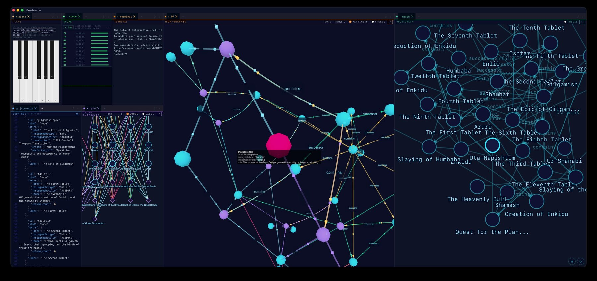
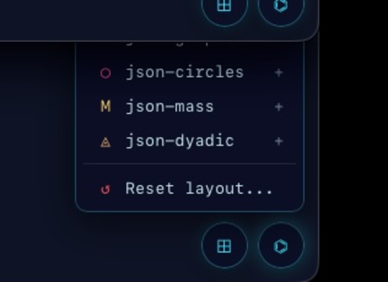

# Exoskeleton

A web-first workspace built on Dockview 8 and React 19 — structure you operate inside while you work. Not a tool you switch to; a chassis your tools live in. The web build is the primary target and runs in a browser on desktop and phone; a Tauri 2 desktop shell for macOS and Linux also lives in this repository (currently on hold and untested for this version).

Licensed under the **GNU Affero General Public License v3.0 or later** ([AGPL-3.0-or-later](LICENSE)).



---

## Why this is different

Draw the same network twice and you get two different pictures — not because
one is wrong, but because there's no single correct way to flatten a tangle of
connections onto a screen. Every layout makes some relationships obvious and
hides others. Most software picks one arrangement and commits to it.

Exoskeleton runs several graph layouts of the same source at once — 2D force,
cytoscape/fcose, 3D force — and keeps them synchronized by **identity rather
than position**. Hover a node in one panel and the same node lights up in the
others. Click it and each panel flies its own camera to that node, in its own
coordinate space, preserving its own embedding. Nothing positional ever
crosses a panel boundary — a sync event names a node; each renderer resolves
that name independently. A node that sits among one crowd in one layout and a
different crowd in another is telling you something neither layout could have
told you alone.

Camera moves animate rather than cut (a tuned transition per renderer), so
each panel stays a place you learn across many selections instead of
re-encountering from scratch on every click.

See [docs/cross-panel-sync.md](docs/cross-panel-sync.md) for the technical
contract, the design rationale, and an honest status table of what's wired up
today versus what the architecture merely makes possible.

---

## What's in the Box

A running Exoskeleton gives you:

- **Dockable Workspace Grid (Desktop & Phone)**: Drag, dock, tab, split, resize, and pop out panel groups into separate browser windows. On phones (`<= 600px`), the grid supports tap-on-active-tab to maximize/restore any pane plus an opt-in **Deck** mode ("One pane at a time" in the **Exo-skeleton** menu) with horizontally scrollable tabs and back-gesture navigation.
- **Workspaces (Schema v8)**: Create, rename, delete, and switch between named workspaces (each storing both a desktop `layout` and a phone `mobileLayout`), export/import standalone `.exo.json` workspace documents, and (on the desktop shell) open independent workspaces in separate OS windows.
- **Layout Presets**: Five built-in presets in [src/persistence/presets.ts](src/persistence/presets.ts) — **Blank Canvas** (`blank`), **JSON Lab** (`json-lab`), **AV Lab** (`av-lab`), **Procedural Lab** (`procedural-lab`), and **Everything** (`everything`) — each with its own desktop and phone arrangement.
- **24 Built-in Panels in `panelRegistry` (28 Registered Components in `src/App.tsx`)**:
  - **JSON Document & Graph Viewers (11 panels)** — share documents over the in-process `json-bus` ([src/data/json-bus.ts](src/data/json-bus.ts)) and coordinate hover/click selection over [src/osc/channels/](src/osc/channels/):
    - **JSON Edit** (`json-edit`): CodeMirror 6 JSON editor (Midnight Alaska theme) with file open/save, live validation, and a **Library** menu of 12 bundled sample graphs; docked in the collapsible left document edge (**⌘J** / **Ctrl+J**).
    - **JSON Tree** (`json-tree`, tab title `tree`): D3 collapsible hierarchy and node tree inspector.
    - **JSON Circles** (`json-circles`, `circles`): D3 SVG radial cluster and circle-packing hierarchy view.
    - **JSON Mass** (`json-mass`, `mass`): Circle packing weighted by substrate mass (text lines, image weight).
    - **JSON Graph** (`json-graph`, `graph`): 2D D3 force-directed graph.
    - **JSON Cytoscape** (`json-cytoscape`, `cyto`): Cytoscape.js (`fcose`) network graph layout.
    - **JSON Graph 3D** (`json-graph3d`, `3d`): Three.js (`react-force-graph-3d`) 3D force-directed graph.
    - **JSON 3D-Inspect** (`json-graph3d-inspect`, `3D-Inspect`): Reading-oriented 3D/2D force graph (`react-force-graph-3d` + `three-spritetext`) with always-on text-sprite node labels, inline edge role/predicate labels, category coloring, and transparent 3D convex containment hulls.
    - **JSON Cosmos** (`json-cosmos`, `cosmos`): GPU WebGL2 force-graph viewer (`@cosmos.gl/graph` + `@luma.gl/*`) built for large graphs (tens of thousands of nodes and links).
    - **JSON Dyadic** (`json-dyadic`, `dyadic`): Categorical layer viewer for TopoThink normalized-dyadic JSON (`containment` as nested spatial enclosures, `state_change` as directed flows, `interactivity` as shared fields, `reference` as lightweight tags — rendered without point-to-point connector lines).
    - **JSON Attention** (`json-attention`, `attention`): Rapier 2D (`@dimforge/rapier2d-compat` WASM) rigid-body field where nodes earn mass from connection and an attention token walks the edges, making the paths it takes heavier.
  - **Text & Extraction (2 panels)**:
    - **Text Viewer** (`text-viewer`): Read-only Markdown flow (`react-markdown`) that renders each graph node as a text block and syncs selection both ways with the graph panels. Its `scroll` controls pane includes a **scroll on hover** switch (`scrollOnHover`, on by default): when turned off, the text flow scrolls only on click or tap.
    - **Topology Extract** (`topology-extract`): Turns a passage of source text (pasted or loaded from a `.txt`/`.md` file) into a normalized-dyadic TopoThink graph using a language model — via **OpenRouter** (cloud API key) or a local **Ollama** server (plus an optional desktop-only local CLI adapter) — with configurable chunking and multi-pass extraction, then pushes the resulting graph onto the `json-bus` document bus and into the session library.
  - **AV Suite (3 panels, communicating over the in-process OSC bus)**:
    - **Tempo Clock** (`tempo-clock`, `tempo`): Visual tempo and beat ticker (24 PPQ over OSC).
    - **Piano** (`piano`): Interactive Web Audio synthesizer keyboard.
    - **Oscilloscope** (`scope`): Real-time Web Audio API frequency/waveform scope.
  - **Procedural Visuals Suite (5 panels, driven over the OSC bus)**:
    - **Procedural Control** (`procedural-visuals-control`, `proc-control`): Central OSC instrument rack controlling the four visualizers below.
    - **Procedural Manifold** (`procedural-visuals-manifold`, `manifold`): 3D parametric topological surfaces (sphere, torus, Möbius strip, Klein bottle, trefoil knot) with GLSL shaders and palettes.
    - **Procedural Balls** (`procedural-visuals-balls`, `balls`): 2D bouncing-balls physics canvas.
    - **Procedural Fountain** (`procedural-visuals-fountain`, `fountain`): Multi-source particle fountain canvas.
    - **Procedural Recursive** (`procedural-visuals-recursive`, `recursive`): Recursive subdivision generative canvas.
  - **General & Desktop Host Panels (3 panels)**:
    - **Web Viewport** (`webview`): In-app iframe browser viewport with URL bar (defaults to `https://dockview.dev`).
    - **Editor** (`editor`): Markdown text editor with native file save/open (requires the `fs` capability on the Tauri desktop host).
    - **Terminal** (`terminal`): Real-shell terminal powered by `@xterm/xterm` v6 + `tauri-plugin-pty` with shell auto-resolution (requires the `pty` capability on the Tauri desktop host).
  - **Shell Components (4 additional components in `src/App.tsx`, not in `panelRegistry`)**:
    - **Blank Panel** (`blank`): Opened by the `+` button in any group header; displays the component picker and replaces itself in place when you pick a panel.
    - **Menu Panel** (`menu`, tab title **Exo-skeleton** in the left edge): Workspace switcher/manager, Document edge toggle, Add panel picker, phone Deck toggle, Reset layout action, and About dialog.
    - **Settings Panel** (`settings`, tab title **Settings** in the left edge, toggled with **⌘B** / **Ctrl+B**): Raw JSON inspector and editor for the active workspace state.
    - **Status Bar Panel** (`status-bar-panel`, mounted as `status-bar` in the bottom edge): Displays the cross-panel sync link toggle (connected/decoupled), active document ID, selected node label, and graph node/edge counts.
- **Fault-Tolerant Panel Error Boundaries**: Any uncaught JS error in a panel is caught by [src/PanelRoot.tsx](src/PanelRoot.tsx), preserving the workspace grid and offering **Retry** and **Close Panel** options.
- **Persistence & Auto-Save**: Debounced flush on state changes, window close, and page unload. Saved workspaces live in the browser's `localStorage` (`exoskeleton_web_state_v8_1`) on the web ([src/persistence/web-storage.ts](src/persistence/web-storage.ts)), and in `exoskeleton.json` in the app's data folder on the desktop ([src/persistence/tauri-storage.ts](src/persistence/tauri-storage.ts)).

### Where the Data Comes From

- **Graph JSON shapes recognised automatically**: The general JSON graph viewers (`json-graph`, `json-cytoscape`, `json-graph3d`, `json-cosmos`, `json-attention`) draw JSON that already has nodes and links. [src/data/json-utils/graphDetect.ts](src/data/json-utils/graphDetect.ts) inspects the active document on `json-bus` and recognises four shapes:
  1. **Node + edge lists**: `{ nodes, edges }` (also matching `vertices`/`elements`/`items` and `links`/`connections`/`relationships`/`arcs`, with endpoint keys `source`/`from`/`src`/`start`/`origin` and `target`/`to`/`dst`/`dest`/`end`/`destination`).
  2. **Incidence-structured hypergraphs**: `{ nodes, edges, incidences: [{ edge, node, role }] }` following the [Hypergraph Interchange Format (HIF)](https://github.com/pszufe/HIF-standard) / TopoThink incidence convention — 2-member edges become direct links, and 3+-member hyperedges are reified as `kind: "hyperedge"` nodes connected by spoke links.
  3. **Edge-object arrays**: `[{ source, target, ... }, ...]` with nodes inferred from endpoints.
  4. **Single rooted node with embedded edges**: `{ node: { id, edges: [{ target_id }] } }`.
- **TopoThink normalized-dyadic JSON**: `json-dyadic` and `json-graph3d-inspect` read TopoThink normalized-dyadic documents (`TopoDocument` in [src/panels/json-dyadic/types.ts](src/panels/json-dyadic/types.ts), documented in [src/panels/json-graph3d-inspect/README.md](src/panels/json-graph3d-inspect/README.md)): `{ metadata, nodes, links }` where n-ary relations are reified into `kind: "hyperedge"` nodes (`c:`, `sc:`, `i:`, `r:` prefixes) with role-labelled spoke links and typed by `i2t:edge_category` (`containment`, `state_change`, `interactivity`, `reference`) and `i2t:predicate`.
- **Bundled sample library**: Twelve ready-to-explore graph documents ship in [src/fixtures/graphs/](src/fixtures/graphs/) (listed in [src/data/library.ts](src/data/library.ts), including *Berry Thief*, *Process Philosophy*, *Epstein Flight Logs*, *Exoskeleton Architecture*, and *Hypergraph Showcase*) and can be loaded at any time from the **Library** menu inside **JSON Edit**.
- **Turning text into a graph in the browser**: The `topology-extract` panel takes a passage of plain text or Markdown, calls a language model through **OpenRouter** (using a user-supplied API key in browser storage) or a local **Ollama** server on your machine/LAN, normalizes the response into a TopoThink dyadic `TopoDocument`, and pushes it directly onto the `json-bus` document bus so all open graph and text viewers update immediately.
- **What this repository does and does not do**: Exoskeleton is the workspace shell, the synchronized multi-layout graph/text viewer suite, and the client-side `topology-extract` panel. It does **not** include the separate upstream `information2topology` (`info2topo`) Python pipeline that generated the bundled static TopoThink sample fixtures, and it does not host or train language models itself — extraction calls out to the OpenRouter or local Ollama endpoint you configure.

---

## Stack

| Concern | Choice |
| --- | --- |
| Primary Runtime | Web browser — desktop & phone ([Vite 7](https://vite.dev/) static build / PWA) |
| Desktop Shell (on hold) | [Tauri 2](https://v2.tauri.app/) (Rust) |
| UI Framework | React 19 + TypeScript |
| Layout / Docking | [Dockview 8](https://dockview.dev) (`dockview-react` ^8.6.0) |
| Graph & Physics Engines | D3, Cytoscape.js (`fcose`), Three.js (`react-force-graph-3d`), [`@cosmos.gl/graph`](https://cosmos.gl/) (WebGL2), [`@dimforge/rapier2d-compat`](https://rapier.rs/) (WASM) |
| Code Editor | [CodeMirror 6](https://codemirror.net/) (`@codemirror/lang-json`) |
| Terminal (desktop host) | [`@xterm/xterm`](https://www.npmjs.com/package/@xterm/xterm) v6 + [`tauri-plugin-pty`](https://github.com/Tnze/tauri-plugin-pty) via [`tauri-pty`](https://www.npmjs.com/package/tauri-pty) |
| Persistence | Browser `localStorage` (`web-storage.ts`) on web; `@tauri-apps/plugin-store` (`tauri-storage.ts`) on desktop + v8 schema migrator |
| Logging | `src/logger.ts` (`tauri-plugin-log` on desktop, `console` fallback on web) |
| License | GNU AGPL-3.0-or-later |

---

## Quick Start (development)

Exoskeleton is **web-first**. You can use the hosted web build in a browser on desktop or phone at [exo-skeleton.org](https://exo-skeleton.org) (installable as a PWA), or run it locally from source.

### Prerequisites

- **Node.js**: 20+ (all that is needed for the web build)
- **For the Tauri desktop shell only (currently on hold)**:
  - **Rust**: 1.77+
  - **macOS**: Xcode Command Line Tools
  - **Linux (Pop!_OS / Ubuntu)**: Tauri Linux dependencies (`libwebkit2gtk-4.1-dev`, `build-essential`, `curl`, `libssl-dev`, `libayatana-appindicator3-dev`, `librsvg2-dev`)

### Run Development Build (web)

```bash
npm install
npm run dev
```

`npm run dev` serves on **port 3805 on all interfaces**, so the workspace is reachable at `http://localhost:3805` and from phones or other machines on your LAN at `http://<your-ip>:3805`.

### Build & Test (web)

```bash
npm run build
npm test
```

`npm run build` runs `tsc && vite build` and writes the production static site to `dist/`.

### Run the Tauri desktop shell (on hold — untested in v2.0.0-beta)

```bash
npm run tauri dev
npm run tauri build
```

First Rust compile is **5–15 min**; subsequent runs are seconds. The desktop shell is on hold and not exercised for this version — see [Known caveats](#known-caveats).

---

## First run

On a **first visit in a browser** (when no saved state exists in `localStorage`), Exoskeleton opens the **JSON Lab** preset (`WEB_DEFAULT_PRESET_ID = "json-lab"` in [src/persistence/presets.ts](src/persistence/presets.ts)) with the bundled sample document **Berry Thief** (`library-berry-thief`, 70 entities and 117 relations) already loaded on the document bus — so the left document edge and the synchronized graph views (`json-tree`, `json-graph`, `json-graph3d`, and `json-cytoscape` on desktop; `text-viewer` and `json-graph3d-inspect` on a phone) show a live graph immediately. (On the Tauri desktop shell, first launch opens `DEFAULT_PRESET_ID = "blank"`.)

On the left edge of the workspace, the **JSON Edit** (**⌘J** / **Ctrl+J**), **Settings** (**⌘B** / **Ctrl+B**), and **Exo-skeleton** tabs are always present; click or tap an inactive tab to open the left edge to that tab, or click the active tab (or its `×` button) to collapse the edge back. The **Exo-skeleton** tab lets you:

- add any panel from the 24-panel registry,
- switch between saved workspaces, or create, rename, and delete them,
- export or import a workspace as a portable `.exo.json` file,
- toggle the left **Document** edge or (on a phone) toggle **One pane at a time** (Deck mode),
- **↺ Reset layout...** to clear the active workspace back to an empty grid.



Whenever the active workspace's grid is empty (after **↺ Reset layout...** or when choosing **Blank Canvas**), the **Watermark** screen appears in the empty grid with clickable preset cards (**Blank Canvas**, **JSON Lab**, **AV Lab**, **Procedural Lab**, **Everything**) and buttons for every panel in the registry.

### Resetting to a known-good layout

You never need to leave the app to recover from a messy grid:

- **Exo-skeleton tab → "↺ Reset layout..."** — reachable at any time, asks for confirmation, and resets the active workspace back to an empty grid showing the Watermark preset cards (`DEFAULT_PRESET_ID = "blank"`).
- To wipe all saved browser state and return to the fresh first-visit experience (**JSON Lab** + **Berry Thief**), clear `localStorage` key `exoskeleton_web_state_v8_1` in your browser's DevTools and reload. On the desktop shell, delete `exoskeleton.json` in the app's data folder (`~/Library/Application Support/` on macOS, or `~/.local/share/` on Linux) and relaunch.

---

## Installing a release build (desktop — on hold)

> **On hold for v2.0.0-beta.** The web build is the primary target — use it in a browser at [exo-skeleton.org](https://exo-skeleton.org) (installable as a PWA on a phone or desktop) or run it locally with `npm install && npm run dev` above. The Tauri desktop install steps below apply to the v1.0.0 desktop binaries on the [Releases](../../releases) page, which are on hold and not refreshed for this version — see [Known caveats](#known-caveats).

### macOS

Exoskeleton is **not code-signed** (no Apple Developer Program membership yet — see [docs/signing.md](docs/signing.md) for the reversible path to fixing that). Because of this, macOS Gatekeeper will refuse to open it and call it "damaged" — that's quarantine, not an actual problem with the download. After installing the `.app` into `/Applications`, clear the quarantine flag once from Terminal:

```bash
xattr -dr com.apple.quarantine /Applications/Exoskeleton.app
```

Then launch it normally. You only need to do this once per install.

### Linux (AppImage)

Make the AppImage executable before running it:

```bash
chmod +x Exoskeleton_*.AppImage
./Exoskeleton_*.AppImage
```

---

## Workspaces & `.exo.json` Documents

Exoskeleton schema v8 provides multi-workspace persistence and portable workspace document serialization. Saved workspaces live in the browser's `localStorage` on the web ([src/persistence/web-storage.ts](src/persistence/web-storage.ts)), and in `exoskeleton.json` inside the app's data folder on the desktop ([src/persistence/tauri-storage.ts](src/persistence/tauri-storage.ts)).

- **Workspace Switcher**: Open the **Exo-skeleton** tab on the left edge to switch between saved workspaces, create new ones, rename, or delete.
- **Export / Import**: Save any workspace configuration as a portable `.exo.json` file to share or back up, and import `.exo.json` files into your workspace list. Imported files are treated as untrusted: any local file path (`filePath`, `sourcePath`) or credential (`apiKey`) a panel had in its parameters is stripped on export and import ([src/persistence/workspace-file.ts](src/persistence/workspace-file.ts)), so importing someone else's workspace never silently opens a local file from your machine or carries over API keys.
- **Multi-Window Workspaces (desktop host)**: On the Tauri desktop shell, click **❐** next to any workspace in the **Exo-skeleton** menu to open it in a separate, independent OS window.

---

## Project Structure

```
exoskeleton/
├── .github/
│   └── workflows/ci.yml             GitHub Actions CI pipeline
├── src/                             React frontend
│   ├── App.tsx                      Main application manifest (28 components) & workspace coordinator
│   ├── PanelRoot.tsx                PanelErrorBoundary + capability guard + PanelPanes wrapper
│   ├── PanelPanes.tsx               Per-panel collapsible control panes bar
│   ├── ColoredTab.tsx               Tab glyph, accent stripe & edge-collapse renderer
│   ├── Watermark.tsx                Empty workspace preset cards & panel picker UI
│   ├── HeaderActions.tsx            Dockview group header controls (≡ menu, ▤, +, ⤴, ⨯)
│   ├── host-capabilities.ts         Runtime capability detection (web vs Tauri fs/pty/multiWindow)
│   ├── chrome/                      Per-panel control pane schemas & registry
│   ├── osc/                         In-process pub/sub OSC bus & cross-panel sync channels
│   ├── data/                        In-process document bus (json-bus), library & graph detection
│   │   ├── json-bus.ts              Active JSON document pub/sub bus
│   │   ├── library.ts               12 bundled sample graph documents
│   │   └── json-utils/              graphDetect.ts, dynamicAdapter.ts, payloadWeigher.ts
│   ├── fixtures/graphs/             Bundled TopoThink & hypergraph JSON fixtures
│   ├── panels/                      Workspace panel implementations
│   │   ├── BlankPanel.tsx           In-group '+' component picker panel
│   │   ├── MenuPanel.tsx            Left-edge Exo-skeleton workspace & preset menu
│   │   ├── StatusBarPanel.tsx       Bottom-edge sync link & graph metrics bar
│   │   ├── EditorPanel.tsx          Markdown editor (desktop fs)
│   │   ├── TerminalPanel.tsx        xterm.js PTY terminal shell (desktop pty)
│   │   ├── LanWebview.tsx           Web iframe viewport
│   │   ├── settings/                Left-edge raw JSON state inspector/editor
│   │   ├── json-edit/               CodeMirror 6 JSON editor & sample library loader
│   │   ├── json-tree/               D3 collapsible hierarchy tree inspector
│   │   ├── json-circles/            D3 radial cluster / circle-packing visualizer
│   │   ├── json-mass/               Substrate-mass weighted circle packing
│   │   ├── json-cytoscape/          Cytoscape.js (fcose) network graph visualizer
│   │   ├── json-graph/              2D D3 force-directed graph visualizer
│   │   ├── json-graph3d/            3D Three.js force graph visualizer
│   │   ├── json-graph3d-inspect/    3D/2D labelled force graph with edge roles & containment hulls
│   │   ├── json-cosmos/             WebGL2 GPU large-graph visualizer (@cosmos.gl/graph)
│   │   ├── json-dyadic/             TopoThink categorical layer visualizer
│   │   ├── json-attention/          Rapier 2D rigid-body field with attention walker
│   │   ├── text-viewer/             Synced Markdown node flow with scroll-on-hover toggle
│   │   ├── topology-extract/        LLM text-to-TopoThink graph extractor (OpenRouter / Ollama)
│   │   ├── tempo-clock/             OSC tempo & beat clock
│   │   ├── piano/                   Web Audio synthesizer keyboard
│   │   ├── scope/                   Web Audio waveform/frequency oscilloscope
│   │   └── procedural-visuals-suite/ OSC control rack + manifold, balls, fountain & recursive visuals
│   ├── persistence/                 Save/load, workspace storage v8 & layout presets
│   │   ├── storage.ts               AppStateV8 & Workspace schema definition + migrations
│   │   ├── app-storage.ts           Runtime storage selector (web localStorage vs Tauri store)
│   │   ├── web-storage.ts           Browser localStorage adapter (exoskeleton_web_state_v8_1)
│   │   ├── tauri-storage.ts         Tauri desktop store adapter (exoskeleton.json)
│   │   ├── document-edge.ts         Dockview 8 left document edge & bottom status-bar edge groups
│   │   ├── deck.ts                  Phone single-group Deck mode conversion
│   │   ├── workspace-file.ts        .exo.json document export/import validation & sanitization
│   │   ├── presets.ts               Blank Canvas, JSON Lab, AV Lab, Procedural Lab, Everything
│   │   └── default-layout.ts        panelRegistry (24 panels), first-run seeding & resetLayout()
│   └── utils/
│       └── debounce.ts              Debouncer with flush() & cancel()
├── src-tauri/                       Rust Tauri desktop backend (on hold in v2.0.0-beta)
│   ├── src/lib.rs                   Tauri plugins, open_workspace_window & run_local_llm commands
│   ├── capabilities/default.json    Tauri permissions (fs, dialog, pty, store, log)
│   ├── tauri.conf.json              Content Security Policy (CSP) & app config
│   └── Cargo.toml
├── docs/
│   ├── cross-panel-sync.md          Identity-based graph sync: contract & rationale
│   ├── ship-plan.md                 Exoskeleton release plan
│   ├── SESSIONS.md                  Handoff & session execution log
│   └── signing.md                   macOS signing & notarization guide
├── LICENSE                          GNU AGPL-3.0-or-later license text
├── package.json
└── vite.config.ts
```

---

## Testing & Quality Assurance

Run the test suite locally:

```bash
npm test
```

This runs Node.js unit tests (`node --test`) covering:
- Graph structure detection (`graphDetect.test.ts`), dynamic JSON adaptation, and TopoThink dyadic parsing (`json-dyadic`, `json-graph3d-inspect`, `json-cosmos`)
- Text Viewer rendering and cross-panel selection/scroll sync (`text-viewer.test.ts`, `selection-bus.test.ts`)
- Topology Extract chunking, prompt building, projection, and OpenRouter/Ollama transport (`topology-extract/*.test.ts`)
- Layout presets, first-run web preset seeding, left document edge, and phone Deck mode (`presets.test.ts`, `first-visit-web.test.ts`, `document-edge.test.ts`, `deck.test.ts`)
- Schema compatibility, v8 workspace management, and web/Tauri storage adapters (`storage.ts`, `workspace.test.ts`, `web-storage.test.ts`)
- `.exo.json` workspace file serialization, untrusted path/key stripping, and validation (`workspace-file.test.ts`)
- Shell resolution (`resolveShell`), auto-add panel migration rules (`panelsToAutoAdd`), and debounce `.flush()` / `.cancel()` controls (`debounce.test.ts`)

---

## License

Exoskeleton is free software licensed under the **GNU Affero General Public License v3.0 or later** ([AGPL-3.0-or-later](LICENSE)).

Use it, fork it, study it, ship it — including commercially, as long as a derived work (or a modified version run as a network service) also releases its source under the AGPL. If you want to build something proprietary on top of Exoskeleton instead, commercial licenses are available separately: email halapenyoharry@gmail.com.

See [CONTRIBUTING.md](CONTRIBUTING.md) before opening a pull request — dual licensing only works while contributions carry a clear inbound grant.

---

# Forking Exoskeleton

Everything below this line is the fork-and-build guide: how the app is put together, how to add your own panel, and what isn't built yet. If you want to make your own web or desktop workspace by editing Exoskeleton, this is the entry point.

## How it's put together

Exoskeleton starts empty. In the browser (or inside a Tauri `WebView` window on the desktop), React mounts and Dockview 8 mounts inside React. At that moment you have a **grid** — a splittable canvas — and it has nothing in it.

What turns the empty grid into the workspace you see is [src/App.tsx](src/App.tsx) together with [src/persistence/default-layout.ts](src/persistence/default-layout.ts) and [src/persistence/presets.ts](src/persistence/presets.ts). Read those and you know what this app *is*.

### The manifest

Two things in `App.tsx` (and `default-layout.ts`) matter.

**First, a map from names to React components in [src/App.tsx](src/App.tsx) (paired with `panelRegistry` in [src/persistence/default-layout.ts](src/persistence/default-layout.ts)):**

```ts
const components = {
  editor: withPanelBoundary(EditorPanel, "editor"),
  terminal: withPanelBoundary(TerminalPanel, "terminal"),
  webview: withPanelBoundary(LanWebview, "webview"),
  // ... 28 registered components in total (24 user panels + 4 shell components)
};
```

The left side of each pair is the *role*. The right side is the *implementation* — the React component that fills the role, wrapped in `withPanelBoundary` ([src/PanelRoot.tsx](src/PanelRoot.tsx)) for error isolation, host capability checks, and per-panel control panes. The role is stable; the implementation is swappable. That's why `WebviewPanel` could be renamed to `LanWebview` without changing anything else — the role kept its name and color.

**Second, an `onReady` function** — what Dockview runs once the grid is mounted. If no saved layout exists, it seeds the default preset ([src/persistence/presets.ts](src/persistence/presets.ts)) by calling `api.addPanel(...)`:

```ts
api.addPanel({ id: "json-tree", component: "json-tree", title: "tree" });
api.addPanel({ id: "json-graph", component: "json-graph", title: "graph", position: { referencePanel: "json-tree", direction: "right" } });
api.addPanel({ id: "json-graph3d", component: "json-graph3d", title: "3d", position: { referencePanel: "json-graph", direction: "right" } });
```

Each call places a panel relative to an existing panel or group (`direction: "right" | "below" | "above" | "left" | "within"`), and `ensureDocumentEdge(api)` attaches the collapsible left document edge and bottom status bar ([src/persistence/document-edge.ts](src/persistence/document-edge.ts)).

### Forking it: adding your own panel

The recipe is two edits (see [AGENTS-template.md](AGENTS-template.md) for the full checklist):

1. Add an entry to `components` in [src/App.tsx](src/App.tsx) (`notes: withPanelBoundary(NotesPanel, "notes")`) and register its metadata in `panelRegistry` in [src/persistence/default-layout.ts](src/persistence/default-layout.ts) so it appears in the **Exo-skeleton** menu, the `+` blank-tab picker, and the Watermark screen.
2. Optionally add an `addPanel` call in a preset in [src/persistence/presets.ts](src/persistence/presets.ts) if it should open by default in a preset.

The component itself comes from one of three places, in increasing order of effort:

- **npm.** `npm install some-react-component`, import it, drop it in the map.
- **Your own file** under [src/panels/](src/panels/), modeled on the existing panels (optionally adding a `manifest.ts` and control panes in [src/chrome/panes/](src/chrome/panes/)).
- **A Tauri plugin** (for desktop-only capabilities), if the panel needs to reach outside the browser sandbox — native filesystem, subprocesses, PTY shells, system dialogs. Plugins are registered in [src-tauri/Cargo.toml](src-tauri/Cargo.toml), granted permission in [src-tauri/capabilities/default.json](src-tauri/capabilities/default.json), and gated in the UI via `requiresCapabilities` on the panel's manifest ([src/host-capabilities.ts](src/host-capabilities.ts)) so the web build degrades gracefully when a desktop-only panel is opened.

### Three rules for when a new thing earns a panel

Panels are first-class citizens, not afterthoughts. Before adding another one, ask:

- **Does it have continuous state?** A panel persists across focus switches and coffee breaks — an open file, a shell session, a loaded URL. If the thing only matters while you're looking at it, it's a modal, not a panel.
- **Is it a distinct mode of work?** A second terminal isn't a new mode — it's a tab inside the existing `terminal` panel.
- **Is there a color slot for it?** The accent in peripheral vision is how the user knows which mode they're in without focused attention. Adding accents indefinitely dilutes that; the right question is usually "should I retire one of the four?", not "should I add a fifth?"

Pass all three and the thing earns its own panel. Pass two and it's a tab inside an existing one. Pass one and it's a modal.

### The schema/state split

Two strict rules that keep things organized:

1. **Schema lives in code.** What panels are *possible*, what colors they get, what their preset arrangements are — that's in `src/App.tsx`, `src/persistence/default-layout.ts`, `src/persistence/presets.ts`, and the panel component files.
2. **State lives in one JSON record.** What's *currently* arranged, what each panel currently holds, what workspaces exist — that's a single schema-v8 JSON blob in browser `localStorage` on the web (or `exoskeleton.json` in the app's data folder on the desktop).

State is always a delta on top of schema. Forking the schema (adding a panel) doesn't break existing users' state. Resetting is one operation: use **↺ Reset layout...** in the **Exo-skeleton** tab, or clear the saved state.

| File / Location | What it tells you |
| --- | --- |
| [src/App.tsx](src/App.tsx) & [src/persistence/default-layout.ts](src/persistence/default-layout.ts) | which panels exist (`components` & `panelRegistry`) and how layouts are applied |
| [src/persistence/presets.ts](src/persistence/presets.ts) | the built-in desktop and phone preset layouts |
| [package.json](package.json) | what React-side and browser-side packages are available |
| [src-tauri/Cargo.toml](src-tauri/Cargo.toml) | what native desktop plugins the Tauri shell has |
| `localStorage["exoskeleton_web_state_v8_1"]` (web) / `exoskeleton.json` in app data (desktop) | the current user state |

### The side-grid

Where earlier versions used a separate `SideGrid` Dockview instance (`src/sidegrid/`), Exoskeleton on Dockview 8 unifies workspace controls into **edge groups** on the main Dockview grid ([src/persistence/document-edge.ts](src/persistence/document-edge.ts)):

- **Left edge group (`document-edge`)**: Holds three structural tabs — **JSON Edit** (`json-edit`, toggled with **⌘J** / **Ctrl+J**), **Settings** (`settings`, toggled with **⌘B** / **Ctrl+B**, implemented in [src/panels/settings/SettingsPanel.tsx](src/panels/settings/SettingsPanel.tsx)), and **Exo-skeleton** (`menu`, implemented in [src/panels/MenuPanel.tsx](src/panels/MenuPanel.tsx)). Clicking the active tab (or its `×` button) collapses the left edge down to its vertical tab strip (`collapsed: true`, 0 px body); clicking any tab expands it back to its remembered width (default 420 px on desktop).
- **Bottom edge group (`status-bar-group`)**: A fixed 28 px bottom strip holding `status-bar` ([src/panels/StatusBarPanel.tsx](src/panels/StatusBarPanel.tsx)).

Both edge groups set `locked: "no-drop-target"` so regular workspace panels cannot be accidentally dragged into them, keeping workspace *controls* and *content* cleanly separated inside a single Dockview instance and a single serialized layout.

### Chrome customization

Dockview provides header and grid slots where Exoskeleton replaces the default rendering, plus a per-panel controls bar inside [src/PanelRoot.tsx](src/PanelRoot.tsx):

| Slot / Wrapper | What it controls | Where in this codebase |
| --- | --- | --- |
| `defaultTabComponent` | What a tab looks like | [src/ColoredTab.tsx](src/ColoredTab.tsx) — glyph + accent color via CSS variable, plus collapse-on-click for left-edge tabs |
| `watermarkComponent` | What's shown when the grid is empty | [src/Watermark.tsx](src/Watermark.tsx) — clickable layout preset cards and the full panel picker |
| `leftHeaderActionsComponent` | The bar right after the tabs | `LeftHeaderActions` in [src/HeaderActions.tsx](src/HeaderActions.tsx) — the active panel's `≡` menu (`manifest.menu`), `▤` restore-controls button, and pane action buttons (e.g. `fit`) |
| `rightHeaderActionsComponent` | The bar on the far right of the header | `RightHeaderActions` in [src/HeaderActions.tsx](src/HeaderActions.tsx) — `⤡` exit-maximized (phone grid), `+` new blank tab (alt-click to clone active tab), `⤴` popout group, and `⨯` close group |
| `PanelPanes` (inside `PanelRoot`) | Collapsible per-panel control cells | [src/PanelPanes.tsx](src/PanelPanes.tsx) & [src/chrome/panes/](src/chrome/panes/) — declarative toggles, sliders, and actions per panel type |

There's no single `headerComponent` slot in Dockview. A custom group header is built by composing `defaultTabComponent`, `leftHeaderActionsComponent`, and `rightHeaderActionsComponent`.

### Persistence

State is saved automatically. Every time a panel is dragged, closed, or resized, the active panel changes, a panel's parameters change, or the left document edge is collapsed/expanded, Exoskeleton debounces 400 ms (and flushes immediately on `beforeunload`/`pagehide` or window close) and writes through [src/persistence/app-storage.ts](src/persistence/app-storage.ts) to:

- **Web browser**: `localStorage` under key `exoskeleton_web_state_v8_1` ([src/persistence/web-storage.ts](src/persistence/web-storage.ts))
- **Desktop shell**: `exoskeleton.json` in the app's data folder (`~/Library/Application Support/` on macOS, or `~/.local/share/` on Linux, via [src/persistence/tauri-storage.ts](src/persistence/tauri-storage.ts))

`version` tracks the layout schema (`CURRENT_VERSION = 11` inside schema v8 `AppStateV8`) — when it changes incompatibly, increment `CURRENT_VERSION` in [src/persistence/storage.ts](src/persistence/storage.ts) and update the migrator. Mismatched-version state falls back to defaults cleanly. Schema v8 introduced named workspaces — see [Workspaces & .exo.json Documents](#workspaces--exojson-documents) above.

**To reset to defaults**: use **Exo-skeleton tab → "↺ Reset layout..."** in the app, or clear `exoskeleton_web_state_v8_1` in browser `localStorage` (or delete `exoskeleton.json` on desktop) and reload.

The persistence layer in [src/persistence/](src/persistence/) is split into focused modules:
- `storage.ts` — environment-agnostic `StorageAdapter` interface, `AppStateV8` / `Workspace` types, and schema migrations.
- `app-storage.ts` — picks `webStorage` in a browser (`isWebRuntime()`) and `tauriStorage` in Tauri.
- `web-storage.ts` — browser `localStorage` adapter.
- `tauri-storage.ts` — Tauri desktop store adapter.
- `document-edge.ts` — Dockview 8 left document edge and bottom status-bar edge group wiring.
- `deck.ts` — phone single-group Deck mode conversion (`toDeckLayout`).
- `default-layout.ts` — `panelRegistry` (24 panels), first-run preset seeding, and `resetLayout()`.
- `presets.ts` — the five named layout presets (`blank`, `json-lab`, `av-lab`, `procedural-lab`, `everything`) for desktop and phone.
- `workspace-file.ts` — `.exo.json` export/import validation and untrusted path/credential sanitization.

### Multi-window

Two independent multi-window mechanisms exist — keep them separate:

- **Popout group** (**⤴** in a group's header): Dockview `window.open` + DOM portal. **Same JS heap** — the panels keep sharing the `json-bus` and OSC bus with the main window. Closing the popout returns the panels to the main grid.
- **Workspace window** (**⌘N** / **❐** next to a workspace on the Tauri desktop host): a genuinely separate Tauri `WebviewWindow` running its own workspace. **Separate JS heap** — no in-process bus reaches it, only Tauri events cross the boundary.

The hypergraph architecture both of these point at — treating OS windows and UI groups as edges of the same hypergraph, with revision-gated IPC for cross-window state sync — is described in [docs/Dockview Tauri Hypergraph JSON.md](docs/Dockview%20Tauri%20Hypergraph%20JSON.md). Today's implementation is simpler for the popout case (shared heap, no IPC needed) and intentionally isolated for workspace windows (separate heap, no IPC at all) — the file format leaves room to grow into the unified approach if a future need for cross-window live state arises.

### Debugging

Where to look when something's wrong:

| Where | What's there |
| --- | --- |
| Browser DevTools (web build) | Elements, Console, Network, and Application → `localStorage` (`exoskeleton_web_state_v8_1`). |
| WebKit Inspector (Tauri debug build) | Auto-opens in desktop debug builds (see [src-tauri/src/lib.rs](src-tauri/src/lib.rs)). Elements + Console + Sources. |
| App log directory (Tauri desktop) | Log file from `tauri-plugin-log` in the OS app-log directory (`~/Library/Logs/` on macOS). Contains both Rust-side and JS-side log calls. |
| The `npm run dev` / `npm run tauri dev` terminal | Vite dev server output (plus Rust stdout in Tauri mode). |

To log from JS across both web and desktop, import from [src/logger.ts](src/logger.ts):
```ts
import { info, warn, error } from "./logger";
info("layout restored");
```
In a browser this logs to `console`; in Tauri it forwards to `@tauri-apps/plugin-log` as well.

### The structure is self-similar

A panel's content is just a React component. A React component can render anything — including a whole `DockviewReact` of its own. Which means one panel can contain its own grid, with its own groups, with its own panels. Each of *those* panels can do the same. The hierarchy is fractal:

```
window
  └─ grid
      └─ groups
          └─ panels
              └─ (each panel's content can be) → another whole DockviewReact
                                                   └─ grid
                                                       └─ groups
                                                           └─ panels ...
```

Same shape at every level, no architectural depth limit — only the practical one of whoever's reading the screen. Each nested Dockview is its own world: independent state, independent drag-and-drop scope, independent layout to persist. You can't drag a tab across the boundary between an outer grid and an inner one; they're peers in topology, not in interaction. Useful when one panel needs to *be* a self-contained mini-workspace (a lab, a scratchpad, a portable mini-IDE). Wrong when you just want more splits — those belong to the outer grid as more groups, not as a nested instance.

## Known caveats

- **Tauri desktop shell is on hold and untested in v2.0.0-beta.** Development since v1.0.0 has been web-first and verified in a browser; the Tauri desktop shell is on hold while a macOS window-server crash during `tauri dev` is investigated. The Rust side still compiles in CI, but no desktop build is published for this version. The next integration planned after the web build is an Obsidian plugin (not yet designed).
- **Muya not yet integrated.** The Markdown editor panel uses a plain textarea. Muya 0.2.5 on npm is the latest published version and is flagged "not for production." Path forward: pin a fork, run from master, or swap to a maintained alternative (Milkdown / Lexical / CodeMirror+remark). The editor's open/save plumbing is independent of the editor surface, so swapping is mechanical.
- **First Rust compile is slow.** Tauri pulls a large dep graph. Expect 5–15 min on first `npm run tauri dev`; future incremental rebuilds are fast.
- **Default webview URL** is `https://dockview.dev` (the docs site for the layout library Exoskeleton wraps). Change `DEFAULT_URL` in [src/panels/LanWebview.tsx](src/panels/LanWebview.tsx) to set a different first-launch default, or just edit the URL bar.
- **Webview is an iframe**, not a native child webview. iframes can't observe `X-Frame-Options`-deny pages. For LAN HTTP services (ComfyUI, Open WebUI, Cockpit, etc.) and most docs sites this works fine. If you need an embed-rejected site, switch to Tauri's `WebviewWindow::new` for a native child surface.
- **OS-level file drop is disabled.** Tauri's native file-drop listener was intercepting Dockview's HTML5 drag-and-drop on macOS WKWebView (the green-plus cursor of doom). Re-enabling it requires intercepting `dragover` at the React level to set `dataTransfer.dropEffect = "move"` for Dockview-originating drags. See [docs/dockviewtips1.md](docs/dockviewtips1.md).
- **Cross-platform compile** is tested primarily on macOS. The same source should `cargo tauri build` on Pop!_OS / Ubuntu once `webkit2gtk-4.1` and friends are installed (see Tauri prerequisites) — CI now builds and tests on `ubuntu-latest` in addition to macOS.

## What's not yet built

- A custom Tauri titlebar (currently uses native macOS chrome).
- Per-group tab position preferences (top / bottom / left / right). Dockview supports these natively; not yet exposed to the user.
- Transparent-on-hover tab chrome (a design choice noted but not implemented).
- New-tab-goes-left-of-active ordering.
- A friendlier preferences UI than the raw JSON editor.
- Undo/redo across layout changes (the JSON format leaves room).
- Cross-window state sync via revision-gated IPC (workspace windows are deliberately isolated for now — see [Multi-window](#multi-window) above).
- A VSCode webview build target and an Obsidian plugin target. (The browser web target is now the primary target in this repository, live at [exo-skeleton.org](https://exo-skeleton.org).)
- Code signing and notarization for macOS builds (documented, not yet executed — see [docs/signing.md](docs/signing.md)).
